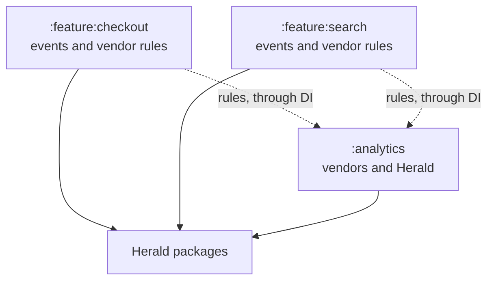
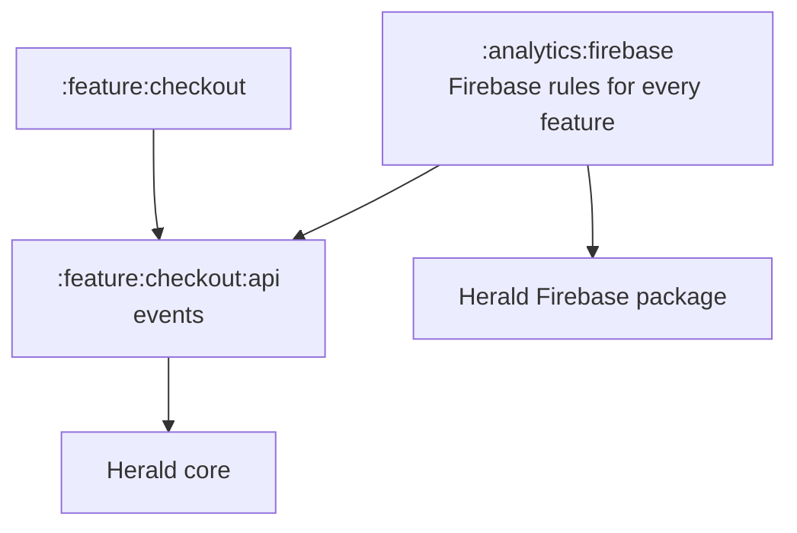
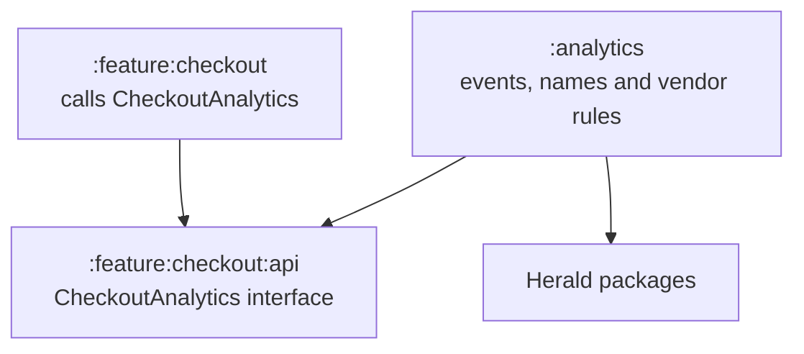
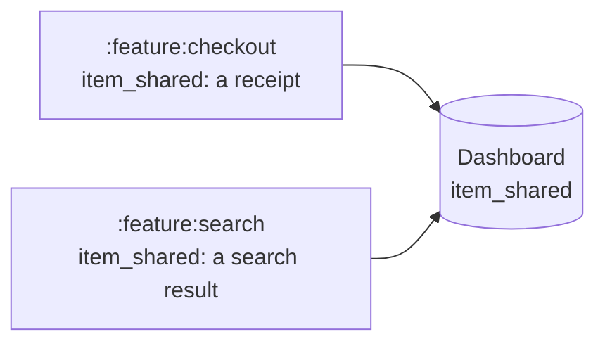

# Modular apps

This page compares three common ways to organise analytics in an app split into feature modules.
Then it shows how to set up the first one, where each feature owns its analytics.

## Choosing a layout

Herald works the same wherever your events and vendor rules live. What you choose is who owns
them: each feature team, or whoever owns analytics. Here are three common layouts.

In the diagrams, a solid arrow means "depends on".

### 1. Each feature owns its analytics

A feature declares its events and the vendor rules they need. The analytics module sets up the
vendors, and gets the rules from DI. [Setting up the first layout](#setting-up-the-first-layout)
shows how.



- **Good:** adding a feature never touches the analytics module. An event and its rules live
  together, owned by the feature's team.
- **Watch out:** a feature with vendor rules depends on those vendors' Herald packages. Two teams
  can pick the same event name. See [Duplicate event names](#duplicate-event-names).

[Moove](https://github.com/MkhytarMkhoian/Moove) uses this layout with Koin. Its `:analytics`
module depends on no feature, and features like `:tickets` and `:inspector` add their own factories.

### 2. Vendor modules own the vendor rules

Features declare their events in small API modules, and know nothing about vendors. Each vendor
gets its own module, which holds that vendor's rules for every feature.



- **Good:** features depend only on Herald's core package.
- **Watch out:** adding a feature also means adding its rules to each vendor module that needs them.

### 3. The analytics module owns everything

Features don't use Herald at all. Each feature declares a small interface, with one method per
thing that can happen, such as `paymentFailed(reason)`. The analytics module implements it, and
holds all the events, their names and the vendor rules.



- **Good:** features know nothing about analytics. A feature's test just passes a fake interface.
  All event names are in one place.
- **Watch out:** each event needs more code: a method, its implementation and the event. The
  analytics module changes with every feature. Keep the interfaces in small API modules, so it
  doesn't depend on the features themselves.

### Side by side

| | 1. Feature owns all | 2. Vendor modules | 3. Analytics owns all |
| --- | --- | --- | --- |
| A feature depends on | Herald packages | Herald core | its own interface |
| Event names live in | the feature | the feature | the analytics module |
| Vendor rules live in | the feature | the vendor modules | the analytics module |
| Adding a feature touches | the feature | the feature and vendor modules | the feature and analytics |
| Good for | teams that own their features | features that shouldn't know vendors | one owner of all analytics |

## Duplicate event names

When features name their own events, two teams can pick the same name for different things. No
vendor complains: the dashboard just shows one event that mixes both.



Ways to prevent it:

- **A prefix per feature,** such as `checkout_item_shared` and `search_item_shared`. Features can't
  clash, and each team stays independent. Renaming existing events breaks old reports, so it's
  easiest from the start.
- **A check in the app module.** The app module sees every feature, so a unit test or a lint rule
  there can read every event name and fail the build on a clash or a missing prefix. Keep a short
  list of names shared on purpose.
- **A tracking plan.** Tools such as Avo, Amplitude Data or Segment Protocols keep every event in
  one plan, and generate the event classes from it. Good for large teams, heavy for a small app.
- **One central list,** such as an enum of every name. Each name exists once, but one file knows
  every feature and changes whenever any of them does.

A prefix plus a check stops clashes and keeps each team independent.

## Setting up the first layout

Factories are what let each feature own its analytics, while the app sets up the vendors without
knowing which features exist.

### A feature ships its own factories

A feature module declares its events. It writes a [factory](../concepts/factory-chain.md) only for
a vendor that needs something special. An event that just needs sending under its own name needs
no factory at all, because the generic factory at the end of that vendor's chain sends it.

So you don't write one factory per feature for every vendor. A factory exists only where a vendor
really needs something different:

- tokens for Adjust;
- conversions for AppsFlyer;
- one of GA4's recommended events.

```text
:feature:checkout    CheckoutFirebaseEventTrackerFactory   (GA4 purchase)
                     CheckoutAdjustEventTrackerFactory     (dashboard tokens)
                     nothing for Amplitude: the generic factory is fine
:feature:profile     nothing at all: every event goes out under its own name
:feature:search      SearchMixpanelEventTrackerFactory     (a super property)
```

### The app collects them

The app module doesn't need to know what a feature's factories are. Each feature hands over its
own, and the app joins them, through your DI library or by hand:

=== "Android"

    === "Koin"

        The feature adds its factory, named after the feature:

        ```kotlin
        --8<-- "samples/guides/ModularApps.kt:koin-feature"
        ```

        The analytics module builds the chain from whatever the features added:

        ```kotlin
        --8<-- "samples/guides/ModularApps.kt:koin-root"
        ```

        !!! warning "Name every factory you add"
            Koin keeps only one of two unnamed definitions of the same type: the module loaded last
            wins, and `getAll` finds just one factory. Give each one a `named(...)` qualifier, such
            as the feature's name.

    === "Hilt"

        The feature adds its factory with `@IntoSet`:

        ```kotlin
        --8<-- "samples/guides/ModularApps.kt:hilt-feature"
        ```

        The analytics module injects `Set<@JvmSuppressWildcards FirebaseEventTrackerFactory>` and
        builds the chain the same way.

=== "iOS"

    The feature module exposes its factories:

    ```swift
    --8<-- "Samples/Sources/Samples/Guides/ModularApps.swift:feature"
    ```

    The app builds the chain from what the features contribute:

    ```swift
    --8<-- "Samples/Sources/Samples/Guides/ModularApps.swift:root"
    ```

=== "Flutter"

    The feature package exposes its factories:

    ```dart
    --8<-- "docs_samples/lib/guides/modular_apps.dart:feature"
    ```

    The app builds the chain from what the features contribute:

    ```dart
    --8<-- "docs_samples/lib/guides/modular_apps.dart:root"
    ```

=== "React Native"

    The feature package exposes its factories:

    ```ts
    --8<-- "docs-samples/src/guides/modular-apps.ts:feature"
    ```

    The app builds the chain from what the features contribute:

    ```ts
    --8<-- "docs-samples/src/guides/modular-apps.ts:root"
    ```

### A DI set has no order

A chain uses the first factory that answers, but a DI set has no order, and the order features
are joined in shouldn't matter either. That's fine while each
feature's factories handle only that feature's events, which they should. Factories whose position
matters go around the injected set, placed by hand:

- Herald's screen-view factory, before the set;
- the generic factory, at the end;
- for properties, Mixpanel's `UserPropertyMixpanelPropertySetterFactory`, which must come before
  the generic one.

### A vendor that may be missing

A factory that takes a vendor object needs that object from DI too. If a vendor may be missing in
some builds, such as Firebase without a `google-services.json`, provide the vendor object as a
`single` that the app's setup code asks for only after checking the vendor exists. The feature's
factory is then never created when the vendor is missing.
